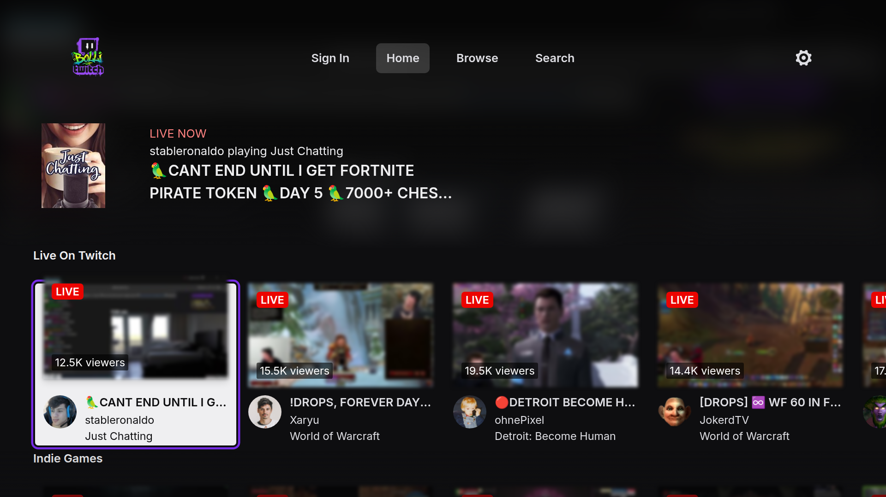
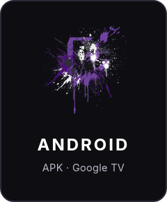
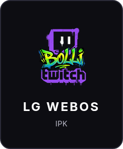
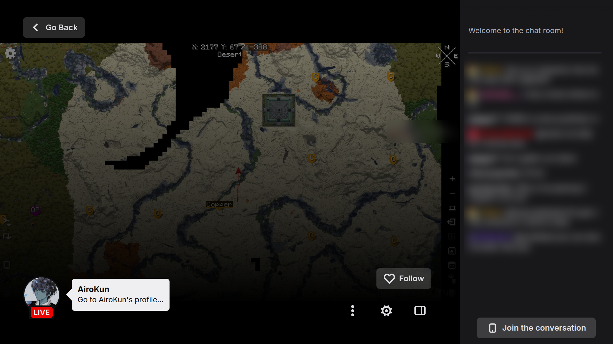
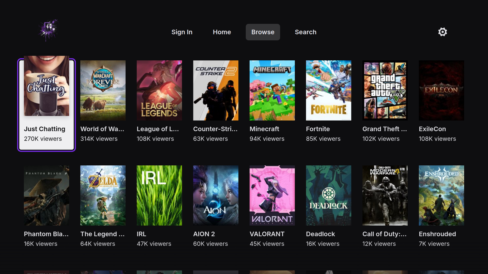

# Bolli Twitch

A Twitch app for LG webOS TVs, Android TV and Google TV. It looks and works like Twitch's own TV app, same screens and same keys, but it's fast, also on old TVs, and it has no ads.

I made it for my own LG C7 from 2017 (webOS 3.9). That's the TV I measure every start on.

Bolli Twitch is not made by or connected to Twitch. You can watch without an account, or sign in with your own Twitch account.

<p align="center"></p>

<p align="center">
  <a href="https://github.com/aktiwers/bolli-twitch/releases/latest/download/bolli-twitch.apk"></a>
  &nbsp;&nbsp;
  <a href="https://github.com/aktiwers/bolli-twitch/releases/latest/download/bolli-twitch.ipk"></a>
</p>

<p align="center">Google TV and Android TV: enter the code <b>6185061</b> in the Downloader app, or open <a href="https://aftv.news/6185061">aftv.news/6185061</a> in a browser.</p>

<p align="center">LG webOS: add the Homebrew repository <code>https://aktiwers.github.io/bolli-homebrew/apps.json</code> in the Homebrew Channel (<a href="#lg-webos">see below</a>).</p>

## What it does

- Home, Following, Browse and Search, like Twitch's TV app: the same layout, focus and remote keys
- No ads: live streams and past broadcasts play ad-free, in full quality up to 1080p60
- Fast: pages stay as you left them when you go back, and what you're likely to open next is fetched ahead
- Chat where you like it: next to the stream like on Twitch, on the left, along the bottom or top, or over the video (Settings › Live Chat). It can scroll as a ticker, show timestamps and avatars and fade old messages, and it has Twitch, 7TV, BetterTTV and FrankerFaceZ emotes. Hide it once and it stays hidden; the yellow button shows and hides it
- Earns channel points while you watch, and claims the bonus for you
- Past broadcasts and clips on every channel page, and with Keep Live Preview (Settings) the channel's live picture stays in view while you look through them
- Sign in with a code: open twitch.tv/activate on your phone (or scan the QR code) and your follows show up
- Search with suggestions as you type
- Pick the quality, and it can remember it for the next streams
- Gift subs and raids show in chat too (you can turn that off in Settings)
- Number keys jump around: 1 Home, 2 Following, 3 Browse, 4 Search

<p align="center">
  
  &nbsp;
  
</p>

## Google TV and Android TV

1. Install **Downloader** (by AFTVnews) from Google Play.
2. Let Downloader install apps: Settings › Apps › Security & restrictions › Unknown sources › Downloader.
3. Open Downloader and enter the code **6185061**. The short link [aftv.news/6185061](https://aftv.news/6185061) or the full address
   `https://github.com/aktiwers/bolli-twitch/releases/latest/download/bolli-twitch.apk` does the same.
4. Install, and open **Bolli Twitch** under Your apps.

A new version installs the same way, over the old one. You stay signed in.

## LG webOS

For LG TVs with the webOS Homebrew Channel (rooted or in developer mode).

It needs webOS 3 or newer. The oldest LG TVs (webOS 1-2, from 2014-2015) can't make the secure connection Twitch requires, so the app opens there but can't load anything.

The easiest way is to add my Homebrew repository. Then Bolli Twitch is in the Homebrew Channel's list, and new versions show up there as updates:

1. Open the Homebrew Channel and go to Settings (the gear).
2. Choose **Add repository** and enter:

   ```
   https://aktiwers.github.io/bolli-homebrew/apps.json
   ```

3. Go back, and install Bolli Twitch from the list.

Or install the IPK directly:

```
https://github.com/aktiwers/bolli-twitch/releases/latest/download/bolli-twitch.ipk
```

## Build it yourself

You need Node.js. The app is plain ES5 for the old Chrome 38 in webOS 3.x.

```
npm install
npm run build
```

That gives you the app in `apps/bolli-twitch`.

The player is [hls.js](https://github.com/video-dev/hls.js), and its source is in `third_party/hls.js` as released. The built copy is already in `apps/bolli-twitch/hls`, so you only need `npm run hls` if you change something there. What my build leaves out, and why, is at the top of `tools/twitch_hls.mjs`.

- **webOS:** `ares-package apps/bolli-twitch` with the webOS CLI, then install the IPK with the Homebrew Channel or `ares-install`.
- **Android:** copy the app into the Android project and build it with Gradle:

  ```
  mkdir -p android/app/src/main/assets
  cp -r apps/bolli-twitch/* android/app/src/main/assets/
  sed -i 's|<meta charset="utf-8">|&\n<meta name="viewport" content="width=1280, user-scalable=no">|' android/app/src/main/assets/index.html
  cd android && ./gradlew assembleDebug
  ```

## Thanks

- [hls.js](https://github.com/video-dev/hls.js) (Apache 2.0): it plays the streams. It brings eventemitter3 (MIT), url-toolkit and the Common Media Library (Apache 2.0) along.
- [tmi.js](https://github.com/tmijs/tmi.js) (MIT): chat's IRC parser is ported from it (tmi.js took it from irc-message by Fionn Kelleher, BSD).
- Font: Inter (SIL Open Font License). QR codes: [QR Code Generator](https://github.com/kazuhikoarase/qrcode-generator) by Kazuhiko Arase (MIT).

## License

GPL-3.0, see [LICENSE](LICENSE).
